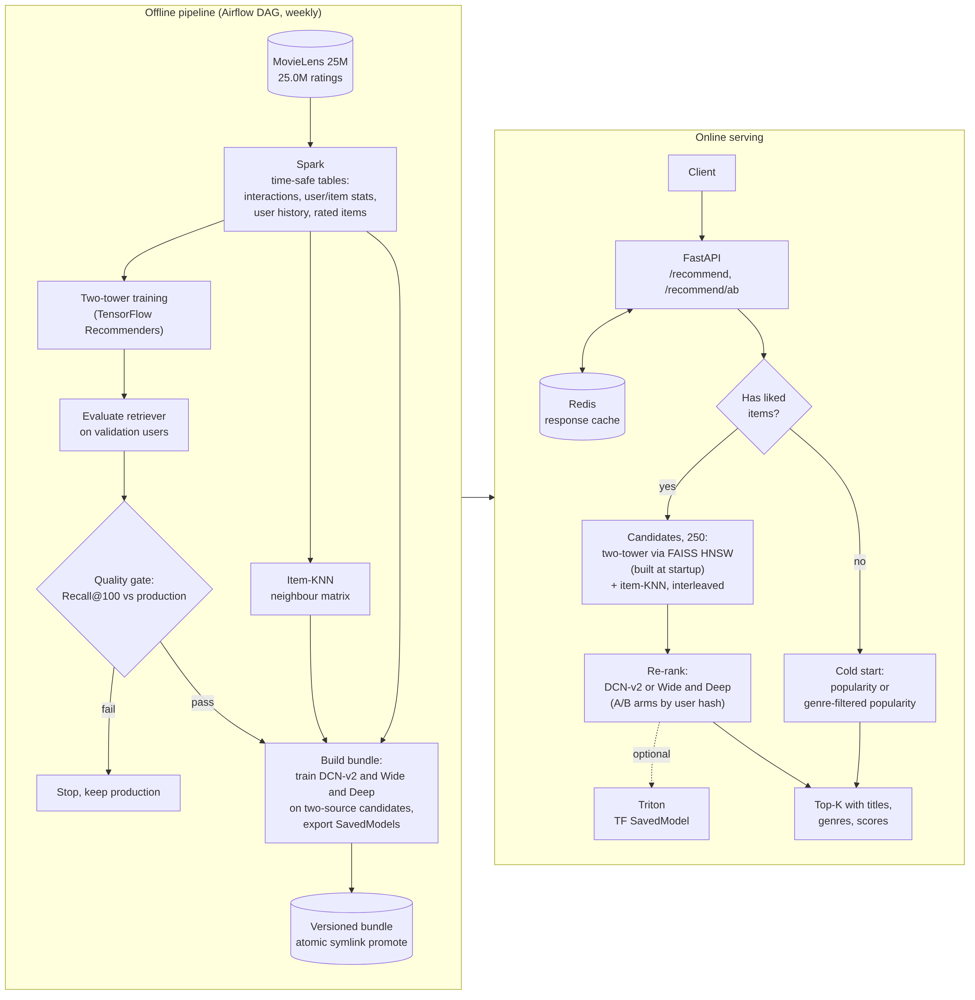

# Personalised Movie Recommendation Engine

A production-style, two-stage recommender built on **MovieLens 25M** (25 million ratings, 162,541 users, 59,047 films). It finds a few hundred promising films for each person, ranks them with a deep model, and serves the result through a cached API.

Built for the Nexvia AI/ML Internship capstone (AIML-03).

**[Try the live demo](https://huggingface.co/spaces/Ram15x/movie-recommender)** · **[Project page](https://ram15x.github.io/personalized-recommendation-engine/)** · [Results](docs/results.md) · [Architecture](docs/architecture.png)

The demo runs on Hugging Face's free tier, so it can take a few minutes to wake up. Pick a few films you like and it returns ranked suggestions from the real model, or leave the picker empty to see the cold-start fallback.



## How it works

1. **Retrieve.** Two sources each suggest candidates: a TensorFlow Recommenders **two-tower** model searched through a **FAISS HNSW** index, and **item-based collaborative filtering**. Together they supply about 250 candidates per user.
2. **Rank.** A **DCN-v2** model orders the candidates. A **Wide & Deep** model runs as the challenger in the A/B test.
3. **Handle new users.** With no history, the system falls back to popularity, optionally filtered by genre.
4. **Serve.** A **FastAPI** service with a **Redis** response cache returns results, and assigns each user to an A/B arm by hashing their ID.
5. **Stay fresh.** **Spark** builds the feature tables, and an **Airflow** DAG retrains the models weekly behind a quality gate before promoting them.

## Results

Everything is measured on a **time split**: train before 2016-06-25, validation before 2018-01-04, test after that. The models are trained once, frozen at the cut-off, and the test window is scored a single time. The test cohort is 6,252 users with at least five prior likes. A film counts as relevant if the user rated it 4.0 or higher in the window and had not rated it before.

| System (test window) | Recall@10 | NDCG@10 | Recall@100 |
|---|---|---|---|
| Popularity | 0.0260 | 0.0728 | 0.1160 |
| Two-tower retriever alone | 0.0328 | 0.0857 | 0.1690 |
| Item-KNN alone | 0.0411 | 0.1091 | 0.1815 |
| **Full system, DCN-v2 ranker** | **0.0514** | **0.1272** | **0.2099** |
| Full system, Wide & Deep ranker | 0.0509 | 0.1273 | 0.2105 |

What stands out:

- **The full system improves on the best single retriever by +0.018 NDCG@10** (95% confidence interval 0.015 to 0.021), and on popularity by +0.054.
- **The two rankers perform the same.** DCN-v2 and Wide & Deep differ by −0.0001 NDCG@10 (interval −0.0014 to +0.0011).
- **The two retrieval sources complement each other.** Item-KNN is the stronger single source, but the two-tower finds different films: together they cover 39.7% of a user's relevant films in 250 candidates, against 38.6% and 36.5% alone.
- **The ranker's gain is smaller on the later test window** (+0.018) than on validation (+0.049). The test number is the one to quote.
- **Serving is fast.** Median latency is 10.6 ms uncached on a 2-CPU container (p95 15.8 ms) and 0.15 ms on a cache hit. The serving path reproduces the offline NDCG@10 (0.184 on 508 held-out validation users).

Full tables, validation numbers and cold-start cohorts are in [`docs/results.md`](docs/results.md); the raw numbers are in `results/`.

## Project status

| Area | Status |
|---|---|
| Data pipeline and time-split evaluation | Complete. `prepare_data.py` was re-run on the full 25,000,095-row file and its output matches the arrays used here (`results/data_prep_verification.json`). |
| Retrieval, ranking, cold start, serving, caching | Complete and tested. |
| Tests | 26 pass on a fresh clone, 34 with a model bundle (the API, Triton-client and trimmed-bundle tests need one). |
| Spark feature tables | Complete. They match an independent NumPy calculation. |
| Airflow retraining | Executed end to end with Airflow 3.1.8, including one run the quality gate blocked and one it promoted (`results/airflow_runs.json`). |
| Live demo | Running on Hugging Face Spaces. |
| A/B testing | Assignment, logging and statistics are implemented and exercised with a simulated replay of held-out likes (CTR 5.43% vs 5.47%, p = 0.85). Real click data would come from live traffic. |
| Triton serving | Both rankers load and serve on a real Triton 24.08 server (CPU). On real 250-candidate requests the HTTP scores match the in-process models (max logit difference 9.5e-7, identical top-10) and a ranker call takes about 5 ms (`results/triton_verification.json`). The full API also ran against it with Redis (11 of 11 answers identical to in-process ranking, median 13.4 ms uncached, 0.43 ms cached; `results/live_triton_check.json`). See [`docs/triton.md`](docs/triton.md). |

## Scope notes

These describe how far the numbers can be read; the full list is in [`docs/limitations.md`](docs/limitations.md).

- **Evaluation setting.** The models are evaluated frozen, about 18 months before the test window, which is a deliberately strict test. In deployment, the weekly retraining DAG keeps them current.
- **New and sparse users.** Users with no history get popularity. For users with one to four likes, only 55 validation users had relevant films, so that group is too small to draw a conclusion about personalisation versus popularity.
- **Catalogue size.** At 34,461 films exact search is already fast, so FAISS HNSW mostly matters at larger scale. It matches exact search on accuracy (Recall@100 0.2321 vs 0.2323) and has a lower median latency (0.41 vs 0.72 ms), though its slowest 1% is higher (4.4 vs 2.2 ms).
- **Retraining.** TensorFlow training is not bit-for-bit deterministic, so a rebuilt model scores very close to, not exactly equal to, the numbers above. The test results belong to the bundle that was evaluated.
- **Data.** MovieLens is explicit ratings from a single domain, and films released after the 2016 cut-off cannot be recommended by the frozen models.

## Quick start

Requires Python 3.12 or 3.13 and Java 17+ (for Spark). The dataset is not redistributed: download [ml-25m](https://grouplens.org/datasets/movielens/25m/) from GroupLens.

```bash
python -m venv .venv && source .venv/bin/activate
pip install -r requirements.txt
export PYTHONPATH=src TF_USE_LEGACY_KERAS=1

python scripts/prepare_data.py ml-25m/ratings.csv data/parts --parts 4      # about 45 s
cp ml-25m/movies.csv data/movies.csv
python scripts/to_parquet.py data/parts data/ratings.parquet
```

### Reproduce the results

```bash
python -m rec.spark_features data/ratings.parquet data/features --train-before 1466837400     # about 30 s
python scripts/train_retrieval.py --parts data/parts --movies data/movies.csv --out runs/tt \
       --epochs 8 --per-epoch 1638400 --lr 5e-4 --l2 1e-6                                      # about 12 min on 2 CPUs
python scripts/itemknn_baseline.py --parts data/parts --movies data/movies.csv \
       --out results/itemknn_val_warm.json
python scripts/eval_retrieval.py --run runs/tt --parts data/parts --movies data/movies.csv
python scripts/build_bundle.py --run runs/tt --knn results/itemknn_val_warm.neighbours.npz \
       --features data/features --parts data/parts --movies data/movies.csv --out bundle      # trains the rankers, exports SavedModels
python scripts/final_eval.py --bundle bundle --parts data/parts --movies data/movies.csv \
       --window val_dev --out /tmp/dev.json
# Test window: run once, when nothing else will change
python scripts/final_eval.py --bundle bundle --parts data/parts --movies data/movies.csv \
       --window test --out results/final_test.json
```

### Run the API

```bash
BUNDLE=bundle REDIS_URL=redis://localhost:6379/0 uvicorn rec.api:app --port 8000

curl -s localhost:8000/recommend -H 'content-type: application/json' \
     -d '{"liked_movie_ids":[260,1196,1210],"k":5}'                           # personalised
curl -s localhost:8000/recommend -H 'content-type: application/json' \
     -d '{"k":5,"genres":["Documentary"]}'                                    # cold start
curl -s localhost:8000/recommend/ab -H 'content-type: application/json' \
     -d '{"user_id":42,"k":5}'                                                # A/B arm by user hash
```

Without Redis the cache simply turns off. `docker compose up` starts the API with Redis, and `--profile triton` adds Triton. The endpoint reference is in [`docs/data_and_api.md`](docs/data_and_api.md).

### Run the demo locally

```bash
BUNDLE=bundle python demo/app.py        # http://localhost:7860
```

How the hosted version is set up: [`docs/deploy_space.md`](docs/deploy_space.md).

### Run the tests

```bash
pytest tests -q                         # unit tests
BUNDLE=bundle pytest tests -q           # adds the API, Triton-client and trimmed-bundle tests
```

## Scheduled retraining

`airflow/dags/retrain_recommender.py` runs `spark_features → train_retrieval → build_knn → evaluate_candidate → quality_gate → build_bundle → promote`. The gate blocks promotion if the candidate's validation Recall@100 falls more than 2% below production, and promotion is an atomic symlink swap, so serving never sees a half-written model. Parameters (`data`, `work`, `epochs`, `per_epoch`, …) are passed with `--conf`.

## Repository layout

```
src/rec/        library: data, features, evaluation, retrieval, index (FAISS), knn, candidates, ranking,
                serving, api, cache, coldstart, store, gate, triton_client, ranker_io, spark_features
scripts/        training, evaluation, bundle and report scripts
airflow/dags/   retrain_recommender.py
triton/         model repository (generated by scripts/make_triton_repo.py)
demo/           Gradio app
deploy/space/   the three files of the Hugging Face Space
tests/          unit and integration tests
results/        JSON outputs behind every number in this README
docs/           architecture, data and API, results, scope notes, Triton and hosting notes
deliverables/   presentation deck and its build script
research/       earlier experiments, kept for history
```

## Tech stack

Python · TensorFlow 2.21 · TensorFlow Recommenders · FAISS · PySpark · Redis · FastAPI · Airflow 3 · Gradio · Triton · Docker. Exact versions are pinned in `requirements.txt`.

## Acknowledgements

Data: [MovieLens 25M](https://grouplens.org/datasets/movielens/25m/) from GroupLens Research, University of Minnesota. Built during the Nexvia AI/ML Internship.
